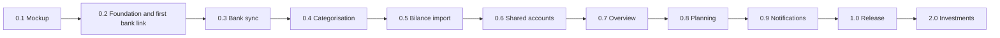

# Saldo roadmap

Saldo is built in versions. Each version adds a set of **features** that you can use when it is done; each version is split into **phases**, one file per phase. Phase ids are `<version>-<n>` (for example **0.3-2**) and are used in the knowledge base ([`../analysis/`](../analysis/README.md)) to link concepts and screens to the work. Every phase has a **size**: S, M or L (below); there are no dates (decision of 3 Nov 2026).

## Order
Set on 3 Nov 2026 (analysis 10 and 11):
1. **Design first** (0.1): the mockup is frozen as the design reference (3 Nov 2026). No more screens in plain HTML/JS: everything else is built in the React app against the Go server.
2. **The real bank connection first** (0.2): it is the base of the app. Saldo runs on the public domain from day one, so sign-in with trusted devices, hardening and a written security baseline come before the first real link, in the same version.
3. **Daily bank sync** (0.3), then **categorisation** (0.4).
4. **The Bilance import before planning** (0.5): the bank API gives about 90 days of history, the forecast needs 12+ months for quarterly and yearly items.
5. **Shared accounts** (0.6), **overview** (0.7), **planning** (0.8), **notifications** (0.9).
6. **Release gate** (1.0): export, full security review, backup and restore, documentation. Then investments (2.0).

## Versions at a glance

| Version | Name | After this version you can … | Analysis | Size | Status |
|---|---|---|---|---|---|
| [0.1](v0.1-mockup/README.md) | Mockup | click through the screens with demo data: the frozen design reference | 12, 13.6 | done | done |
| [0.2](v0.2-foundation/README.md) | Foundation and first bank link | install the add-on, sign in on your domain on trusted devices, and see your real Argenta accounts and transactions | S1, M0, 6, 7 | 1 S · 3 M · 2 L | built, to verify |
| [0.3](v0.3-bank-sync/README.md) | Bank sync | rely on a nightly sync without duplicates, consent reminders, Transacties, Rekeningen, manual accounts and a CSV import | M1 | 1 S · 4 M · 1 L | in progress |
| [0.4](v0.4-categorisation/README.md) | Categorisation | have rules categorise transactions and fix the rest in a tap | M2 | 1 S · 3 M | planned |
| [0.5](v0.5-bilance-import/README.md) | Bilance import | bring in your full Bilance history, mapped to your categories, without duplicates | S2, M6 | 2 S · 4 M | planned |
| [0.6](v0.6-shared-accounts/README.md) | Shared accounts | share the joint account with Partner, each seeing only your own accounts | M3 | 2 S · 2 M · 1 L | planned |
| [0.7](v0.7-overview/README.md) | Overview | see income, spending and savings per period, per account and category | M4 | 1 S · 2 M | planned |
| [0.8](v0.8-planning/README.md) | Planning | know how each coming month ends for each account, and how much is free to spend | M5 | 1 S · 2 M · 3 L | planned |
| [0.9](v0.9-notifications/README.md) | Notifications | get push (Android and iPhone) and e-mail warnings before an account goes into its buffer or below zero | 4.9 | 2 S · 3 M | planned |
| [1.0](v1.0-release/README.md) | Release | run Saldo with a full security review, tested backups and an export | 13.4 | 3 S · 1 M | planned |
| [2.0](v2.0-investments/README.md) | Investments | see net worth per platform | v2 | 1 S · 2 M | later |

**Sizes** are relative effort, not dates: **S** = a few days of focused work, **M** = about a week, **L** = about two weeks or more. They help to pick the next phase and to see which versions are heavy (0.2 and 0.8).

**Real data:** from 0.2-6 on, Saldo holds your real bank data on the live add-on. The fake bank provider serves the demo story for tests and local development only; CI never calls a real bank. Nothing real is ever committed: the repository is public.

## Release policy
- From 0.2 on, every version ends with a tagged add-on release `0.N.0`: CI builds the multi-arch images (amd64, aarch64), pushes them to `ghcr.io`, and Home Assistant offers the update from the repository URL. Fixes in between are `0.N.x`.
- A database backup is taken before every update that migrates the schema (Home Assistant backup, encrypted).
- Version 0.1 (the mockup) is not an add-on; it is served by `finance-mockup/serve.ps1`.
- 1.0.0 follows the full security review (1.0-2) and the restore test (1.0-3).

## Features per version
Feature ids are stable; phase files list the features they deliver. **[S]** = should, **[C]** = could (analysis 4).

### 0.1 · Mockup
| Id | Feature | Phase |
|---|---|---|
| UI-1 | Design system: colours, type, components, icons, light and dark | 0.1-1 |
| UI-2 | Clickable Start, Transacties, Overzicht, Planning, Rekeningen, Meer, Meldingen | 0.1-1 … 0.1-4 |
| UI-3 | E-mail templates and push notification previews | 0.1-5 |
| UI-6 | The decisions of 3 Nov 2026 in the mockup: independent accounts, sums as information, demo states | 0.1-6 |
| UI-4 | Designs for sign-in, bank linking, account detail, categories, import, settings and the remaining states (partly; the rest in the React app) | 0.1-7 |
| UI-5 | Frozen mockup as the design reference | 0.1-8 |

### 0.2 · Foundation and first bank link
| Id | Feature | Phase |
|---|---|---|
| PLAT-1 | Verified bank API facts (spike S1) | 0.2-1 |
| PLAT-2 | Home Assistant add-on: Go server, SQLite, migrations, health, logs, CI, images on GHCR | 0.2-2 |
| PLAT-3 | Web app (PWA) on Android and iPhone: shell, navigation, Dutch UI, light and dark | 0.2-3 |
| ACC-1 | Sign in with e-mail, password and an 8-digit e-mail code | 0.2-4 |
| ACC-2 | First-admin setup link, invite users, admin reset link, admin recovery | 0.2-4 |
| ACC-3 | Log in with Home Assistant, still followed by the e-mail code [C] | 0.2-4 |
| ACC-4 | Trusted devices with a device list, and a new-device e-mail (push from 0.9-2) | 0.2-4 |
| SEC-0 | Security baseline and public access before the first real bank link | 0.2-5 |
| BANK-1 | Enable Banking setup per user (application id and private key) | 0.2-6 |
| BANK-2 | Link Argenta, choose accounts, re-authorise; Bankkoppelingen screen | 0.2-6 |
| PLAT-4 | Fake bank provider with the demo story, for tests and local development | 0.2-6 |

### 0.3 · Bank sync
| Id | Feature | Phase |
|---|---|---|
| BANK-3 | Nightly sync and "Sync now", bank balances, pending transactions, no duplicates | 0.3-1 |
| BANK-4 | Consent and sync status, reminders in the app and by e-mail (14 and 3 days) | 0.3-2 |
| TX-2 | Transacties: list by day, search, filters, detail | 0.3-3 |
| ACCT-1 | Rekeningen and account detail: name, colour and buffer per account; manual accounts and balances | 0.3-4 |
| ACCT-2 | Start: balance now per account, accounts, sync and bank alerts | 0.3-5 |
| TX-1 | CSV import (generic, Argenta export) | 0.3-6 |

### 0.4 · Categorisation
| Id | Feature | Phase |
|---|---|---|
| CAT-1 | One shared category tree with a Dutch default set | 0.4-1 |
| CAT-2 | Rules on counterparty, communication and amount, with priorities | 0.4-2 |
| CAT-3 | Change a category, "apply to similar and create a rule", notes | 0.4-3 |
| CAT-4 | Split a transaction over categories [S] | 0.4-3 |
| CAT-5 | Categorieën en regels screen with suggestions to confirm | 0.4-4 |

### 0.5 · Bilance import
| Id | Feature | Phase |
|---|---|---|
| PLAT-1 | Verified Bilance file layout (spike S2) | 0.5-1 |
| IMP-1 | Import wizard with a saved Bilance preset | 0.5-2 |
| IMP-2 | Category mapping: map, create, merge or leave, saved per source | 0.5-3 |
| IMP-3 | Import cutoff and probable duplicates | 0.5-4 |
| IMP-4 | Import batches with undo | 0.5-5 |
| IMP-5 | Learned category suggestions and backfill | 0.5-6 |

### 0.6 · Shared accounts
| Id | Feature | Phase |
|---|---|---|
| SHARE-1 | Join a shared account by IBAN; manager and members with Lezen or Bewerken | 0.6-1 |
| SHARE-2 | Fallback bank sources, leave, manager hand-over, remove a link, delete a user | 0.6-1 |
| SHARE-3 | Privacy: every figure comes from your own accounts only (tested on every endpoint) | 0.6-2 |
| SHARE-4 | Internal transfers left out, transfers to savings shown as saved, "is / is not a transfer" [S] | 0.6-3 |
| SHARE-5 | Scope switch Alles · Persoonlijk · Gedeeld as a filter, sums as information only | 0.6-4 |
| SHARE-6 | Contributions to the shared account | 0.6-5 |

### 0.7 · Overview
| Id | Feature | Phase |
|---|---|---|
| OVER-1 | Income, expenses and saved per month, quarter, year or custom range, per account and as a sum | 0.7-1, 0.7-2 |
| OVER-2 | Category breakdown with share, trend and drill-down to transactions | 0.7-1, 0.7-2 |
| OVER-3 | Start: spending this month and contributions | 0.7-3 |

### 0.8 · Planning
| Id | Feature | Phase |
|---|---|---|
| PLAN-1 | Recurring items detected from history and confirmed by you, or added by hand | 0.8-1 |
| PLAN-2 | Budgets per account and category, or the average of past months | 0.8-2 |
| PLAN-3 | Plan a one-off expense or income from the calendar | 0.8-3 |
| PLAN-4 | Forecast per account: months (3 to 24) and daily balance, buffer and red states | 0.8-4 |
| PLAN-5 | Free to spend per account and month | 0.8-5 |
| PLAN-6 | Planning screen with five tabs; forecast and warnings on Start | 0.8-6 |

### 0.9 · Notifications
| Id | Feature | Phase |
|---|---|---|
| NOTIF-1 | All ten e-mails, with plain-text parts, tested in three mail clients | 0.9-1 |
| NOTIF-2 | Push notifications on the installed app, on Android and iPhone | 0.9-2 |
| NOTIF-3 | Warnings for red and buffer per account, member joined, new device, to categorise; once per account, month and state | 0.9-3 |
| NOTIF-4 | Meldingen settings: per type and channel, look-ahead, quiet hours, test notification | 0.9-4 |
| NOTIF-5 | Lock screen without amounts, checked on both phones | 0.9-5 |

### 1.0 · Release
| Id | Feature | Phase |
|---|---|---|
| DATA-1 | Export your data to CSV and JSON [S] | 1.0-1 |
| SEC-1 | Full security review | 1.0-2 |
| REL-1 | Backup, restore and migration routine | 1.0-3 |
| REL-2 | Add-on release 1.0.0 with documentation | 1.0-4 |

### 2.0 · Investments
| Id | Feature | Phase |
|---|---|---|
| INV-1 | Investment accounts with manual or imported values | 2.0-1 |
| INV-2 | Net worth per platform | 2.0-2 |
| INV-3 | Price lookups by ISIN [C] | 2.0-3 |

## Concepts per version
Generated from the "Concepts" row of every phase file.

<!-- concept-matrix -->
| Concept | 0.1 | 0.2 | 0.3 | 0.4 | 0.5 | 0.6 | 0.7 | 0.8 | 0.9 | 1.0 | 2.0 |
|---|---|---|---|---|---|---|---|---|---|---|---|
| [account](../analysis/concepts/account.md) | ● | ● | ● |  |  | ● |  |  | ● | ● | ● |
| [app-shell](../analysis/concepts/app-shell.md) | ● | ● |  |  |  |  |  |  |  |  |  |
| [authentication](../analysis/concepts/authentication.md) | ● | ● |  |  |  |  |  |  |  | ● |  |
| [bank-connection](../analysis/concepts/bank-connection.md) | ● | ● | ● |  |  | ● |  |  | ● | ● |  |
| [budget](../analysis/concepts/budget.md) | ● |  |  |  |  |  |  | ● |  |  |  |
| [buffer-and-states](../analysis/concepts/buffer-and-states.md) | ● |  | ● |  |  | ● |  | ● | ● |  |  |
| [categorisation-rule](../analysis/concepts/categorisation-rule.md) | ● |  |  | ● | ● | ● |  |  | ● |  |  |
| [category](../analysis/concepts/category.md) | ● |  |  | ● | ● |  | ● |  |  |  |  |
| [demo-data](../analysis/concepts/demo-data.md) | ● | ● |  |  |  |  |  |  |  |  |  |
| [design-system](../analysis/concepts/design-system.md) | ● | ● |  |  |  |  |  |  | ● |  |  |
| [forecast](../analysis/concepts/forecast.md) | ● |  |  |  |  |  |  | ● | ● |  |  |
| [import](../analysis/concepts/import.md) | ● |  | ● |  | ● |  |  |  |  |  |  |
| [internal-transfer](../analysis/concepts/internal-transfer.md) | ● |  |  |  |  | ● | ● | ● |  |  |  |
| [money-and-format](../analysis/concepts/money-and-format.md) | ● | ● |  |  |  |  |  |  |  |  |  |
| [notification](../analysis/concepts/notification.md) | ● | ● | ● |  |  |  |  |  | ● |  |  |
| [period-overview](../analysis/concepts/period-overview.md) | ● |  |  |  |  |  | ● |  |  |  |  |
| [planned-item](../analysis/concepts/planned-item.md) | ● |  |  |  |  |  |  | ● |  |  |  |
| [recurring-item](../analysis/concepts/recurring-item.md) | ● |  |  |  |  |  |  | ● |  |  |  |
| [scope](../analysis/concepts/scope.md) | ● |  | ● |  |  | ● | ● | ● |  |  | ● |
| [shared-account](../analysis/concepts/shared-account.md) | ● | ● |  |  |  | ● | ● | ● | ● |  |  |
| [transaction](../analysis/concepts/transaction.md) | ● | ● | ● | ● | ● | ● |  |  |  |  |  |
| [user-and-visibility](../analysis/concepts/user-and-visibility.md) | ● | ● |  |  |  | ● |  |  |  | ● |  |
<!-- /concept-matrix -->

## Toolchain note
The development machine has no Node.js, Go or Python (checked 3 Nov 2026). Version 0.1 is plain HTML, CSS and JavaScript without a build step. Version 0.2 needs Go and Node installed, with the organisation proxy set for `go` and `npm` (analysis 13.5). Real bank data never lives on the development machine.